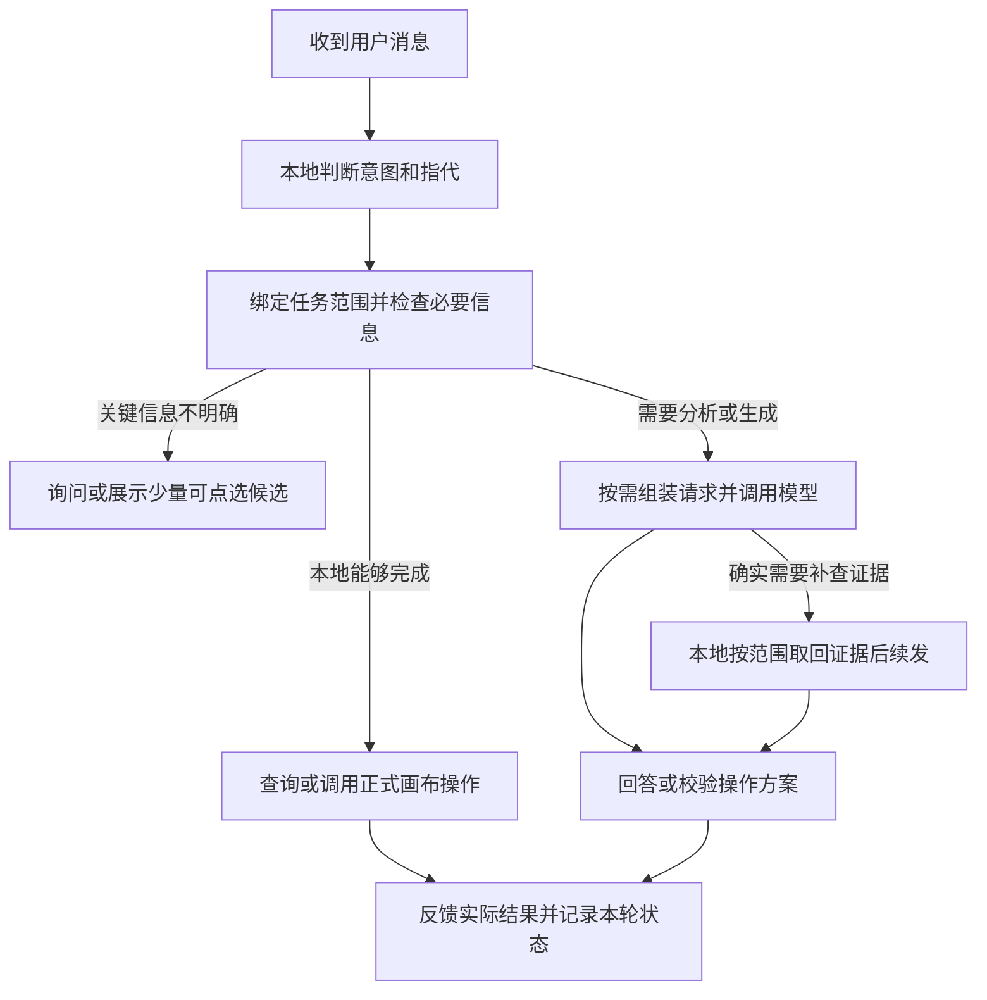

# Echo-8 AI 助手对话与画布操作设计

状态为设计稿，供后续实现和验收。目标是让用户按习惯说中文，让助手准确接住多轮对话，并减少完成同一件事所需的模型请求、Token 和等待时间。

## 1. 一条消息的处理流程

| 用户说法 | 本轮意图 | 本地处理 |
| --- | --- | --- |
| 「第三人称限知是什么意思？」 | 普通聊天 | 使用本轮问题和适用的偏好。 |
| 「这三张卡怎么排比较好？」 | 读取画布并讨论 | 获取必要的尺寸和位置，回答排法。 |
| 「能帮我把这三张横着排吗？」 | 操作画布 | 把礼貌问句视为执行请求，绑定三张卡并计算布局。 |
| 「先别改色，告诉我哪张太暗」 | 只读分析 | 可读取相关颜色，按明确的否定限制关闭写入。 |
| 「总结这三张卡，写进『提要』」 | 读取、生成并写入 | 三张卡是证据来源，「提要」是唯一写入目标，模型生成摘要。 |
| 「处理一下这个」 | 需要澄清 | 从上下文尽量确定对象，再询问具体要做什么。 |

先使用用户明确点名或 `@` 引用的对象。用「选中的」读取本轮选区，用「刚才那条」回查最近相关任务或已提交结果。用稳定 ID 和相关修订绑定对象，标题和简称用于查找。重名、选区数量不符或者指代指向多个可信对象时，标出候选并问一个最有用的问题。用户选定后接着处理原请求。否定、假设、咨询、礼貌请求和引用中的命令文字分别处理。模型能辅助理解模糊表达，写入范围由用户请求和本地校验决定。

## 2. 本地完成、模型调用和补查的边界

| 路径 | 进入条件 | 示例 |
| --- | --- | --- |
| **零云端调用** | 动作、对象、参数均可确定，且已有正式操作支持。 | 「把这两张弄成蓝色」「新建一张空白卡」「把原句填进提要」「横排，间距 80」「刚才改成功了吗」。 |
| **一次模型调用** | 任务需要理解、比较、创作或输出方案，必要资料可在请求前定位。 | 普通问答、改写、总结、按剧情关系排布、设计配色。理解意图和给出结果可在同次请求完成。 |
| **模型返回补查要求后续发** | 关键资料要看过第一批证据才知道去哪里找。 | 询问为何放弃第二版。首轮只找到决定，模型提出查找更早的开场节奏讨论，Echo-8 找到相关原话后带回给模型。 |
| **向用户澄清** | 对象身份、授权范围或结果取决于用户自己的选择。 | 两个话题都有「第二版」，展示「开头」和「结局」供点选。 |

先走确定性解析和现有本地计划。对适合的口语输入，可用现有浏览器本地语义分类补充识别，随后仍需解析参数并核验范围。分类分数用于判断是否接纳，直接执行还取决于对象、参数和操作影响。独立聊天无需云端意图预判。常见任务不等待首次下载本地模型资源，加载不可用时按任务进入已有规则、澄清或合适的模型路径。

补查请求带明确目标和范围，优先靠本地索引、标题、关系或原文范围查询。默认优先争取一次有用的补查即可完成，预算按任务和提供方能力有界配置。结果充分时及时作答，搜不到时说明证据缺口。工具续发保留提供方要求的调用和结果配对，避免把配对内容再次包装成说明。

## 3. 画布能力覆盖和执行

以现有手动操作为清单，逐项标注所属插件、对象类型、参数、支持的读取和写入范围、确认方式、撤销语义及测试。助手与界面复用公开指令或带版本能力。下表是后续覆盖范围，具体支持程度以能力盘点和测试为准。

| 类别 | 纳入覆盖的操作 |
| --- | --- |
| 节点与正文 | 创建、填写、追加、替换、编辑标题、选择与切换到指定节点、节点形态切换、移动、相对摆放、排列、对齐、复制、粘贴、剪切、删除、改色。 |
| 连接线 | 创建、重接、删除、改线型和颜色、添加或编辑线上的文字、添加中转点。 |
| 群组 | 建组、解组、重命名、增减成员、移动、排列和改色等现有操作。 |
| 标注 | 新建、填写和编辑内容、修改颜色、改变锚点或删除等现有操作。 |
| 画布与界面 | 导航和定位、切换主题、修改背景和导航栏颜色。文档、个人偏好和临时视图按各自所有者的规则处理。 |
| 历史与结果 | 查询待确认、已执行、失败、撤销或已失效的任务，通过现有入口撤销、重做。 |

### 范围、批量与接续

- 「把『人物』组里没连线的卡排成两列，主角留在原位」用组、连线状态、排布方式和例外表达。程序本地筛选和排序，按需高亮范围并显示影响数量。固定参数采用产品一致的默认值，例如「往右一点」采用约定步长，「横排」默认保留现有从左到右顺序。具体值在实现前根据现有行为与用例确定。
- 结构性筛选和计算留给程序。语义筛选先用标题、关键词或可用索引找候选，再用少量原文核验。「发生了火灾」和「差点发生火灾」的证据应得出不同结果，有歧义的候选供用户复核。
- 「改成三列，间距照旧」只修改列数。「说错了，是『反派』组」重新绑定对象并复用其他有效参数。待确认方案更新后重新校验，已执行的方案按新一轮请求处理。用户离开画布、换书、手动编辑、撤销或改变选区时，按原任务的绑定规则重新核对。
- 已绑定的正文目标由程序锁定稳定 ID、修订和写入范围。模型输出生成文字。程序验证追加、替换、段落偏移和原样保留等约束，插入或覆盖走对应的正式操作。

### 执行和反馈

目标唯一、影响明确的可逆操作按现有直接模式策略处理。删除、覆盖正文或大范围修改优先明确展示目标和影响供确认。批量任务在接受范围内统一校验和提交，允许按项应用时沿用现有依赖和修订校验。一批文档修改通过核心原子事务进入全局撤销历史。导航、焦点和临时预览走对应的视图消息，个人偏好使用独立的持久化路径。

计划提交前核对权限、对象类型、源和目标修订、交互状态及业务约束。同一操作的重试通过原提交身份查回执并防止重复提交。源或目标变化时重新准备，旧计划失效。反馈以程序结果为准，区分真失败、结果未知、已提交、已撤销、待确认和已失效。后续同义追问先查回执。撤销沿用全局线性历史。如果「只撤掉刚才移动的」已经和后续操作交错，先核对当前历史和对象，按现有能力提供可解释的处理方式。

## 4. 普通对话和长期上下文

| 情况 | 本地保留或读取的内容 |
| --- | --- |
| 独立问题 | 当前原话和与本轮相关的偏好。 |
| 就近追问 | 最近相关的原话，必要时精确到被引用的段落或列表项。 |
| 回到旧话题 | 简短话题进度，包含正在解决的问题、有效约束、候选方案和草稿版本引用。 |
| 查询旧决定或原句 | 用索引定位，再从可验证的原文范围核实，说话者、顺序和版本随证据保留。 |
| 继续编辑某一版 | 读取明确对应的草稿原文及用户仍然有效的要求。 |

- 保留分块的原始对话。摘要在上下文逼近预算或话题阶段结束时按需要更新，记录索引和当前进度。旧事实、数字、原句或具体草稿由原文核实，摘要为回查提供线索。普通问答和已由程序记录的操作状态无需每轮额外调用模型生成摘要。
- 区分助手提出的建议、用户确认的决定、后来修订或废弃的内容和已经发生的操作。用任务、会话、项目或长期偏好范围表示规则的适用性。「这段短一点」属于当前任务，「这本小说用第一人称」属于项目，「以后先给结论」才适合作为长期偏好。
- 「给我两个开头」→「第二个更好，先留着」→ 聊别的话题 →「刚才那个压到 200 字，第一句保留」。最后一轮应定位第二版并引用原文，沿用有效约束。近期聊天较长时，按相关性补取必要原话。多个版本同样符合指代时先澄清。
- 跟随用户想要的结果控制回答篇幅。「哪个好」先给选择和理由，「详细比较」再给依据和取舍，「继续第二点」就从第二点展开。只有足以改变答案的歧义才补问。

## 5. 发给模型的内容和预算

1. **简短的固定规则。** 保持基础前缀稳定，本轮确实需要的画布、检索或正文约束才加载。只提供本轮可用的工具或返回格式。
2. **必要的事实、历史与资料。** 保留相关用户原话的角色，按来源、修订和范围合并重叠证据。相同资料正文只带一份，保留独立来源和适用范围。保留语义上独立的重复确认和必要的工具调用配对。
3. **本轮用户原话。** 作为当前用户消息保留一次。已绑定对象用少量字段和简短代号表达。有写入目标的生成只发送完成生成所需的数据。引用的文档、标注和外部文字按资料处理，其内容不授予执行权限。
4. **按任务分配输入和输出额度。** 改色只需颜色和范围，移动只要布局信息，续写取相关正文，开放生成按需求给篇幅。预算优先保证本轮目标、明确引用和有效限制。较长材料按范围读取，确实需要扩大范围时报告缺口并有界补查。

外发证据限于本轮权限范围，私密节点按现有规则默认排除。证据检索、准备和模型任务可取消，过期请求不会应用结果。现有请求检查和用量账本可继续显示本轮发了哪些资料、为何使用、近似 Token 和调用目的。记录服务商用量、估算和未知值的区别。任务总成本包括工具续轮、传输重试、纠正、续写和记忆提炼。等待时间分别看首次模型资源加载和日常调用。

## 6. 数据从哪里来，怎样验收

### 现有数据和独立样本

- **仓库测试可立即作为回归基线。** 已有口语建卡、批量改色、分组连线、撤销重做、追问防重、语义过滤、历史回查和固定请求用量样本。 [画布端到端场景](../e2e/helpers/canvas-control-scenario.ts) · [自然语言规则](../tests/natural-canvas-rules.test.ts) · [记忆验收样本](../tests/fixtures/ai-memory-evaluation.ts) · [用量样本](../tests/fixtures/ai-efficiency-scenarios.ts)
- **公开语料可补口语和对话变化。** FewJoint 用于中文意图和参数，RiSAWOZ 用于多轮指代和省略，HammerBench 中文版用于改口、参数变化和工具调用。相近题映射到 Echo-8 支持的操作，通用题可检查聊天分流和误写入。 [FewJoint](https://github.com/AtmaHou/MetaDialog#updates) · [RiSAWOZ](https://github.com/terryqj0107/RiSAWOZ) · [HammerBench](https://github.com/MadeAgents/HammerBench/blob/main/README.md)
- **独立画布样本用于测本产品端到端正确率。** 可以从未看过训练样本的人做任务时收集，也可经用户同意使用脱敏后的实际说法。每条记录初始画布、选区和必要的历史、用户原话、预期路径、对象和参数、最终变更或澄清。已有 162 条人工标注用于训练，另留独立样本作评估。建议先整理 200～300 条作为初版，样本量和分布随实测结果调整。 [本地意图设计及已验证场景](ADR-0153-LOCAL-CANVAS-INSTRUCTION-UNDERSTANDING.md)

### 观察指标

| 指标 | 如何统计 |
| --- | --- |
| 本地覆盖和执行正确率 | 能本地独立完成的任务占比，和本地直接执行中实际做对的比例，同时报告分母。 |
| 意图、对象与参数 | 核对聊天、只读、执行和澄清是否走对路径，再核对选中对象、顺序、数量、颜色、距离及保留条件。 |
| 误操作与回复事实 | 核对误写入、误删除、错误回执、重试重复执行和过期提交。明确禁止写入、对象歧义、目标修订冲突等用例逐条检查。 |
| 多轮连续性 | 检查旧决定、改口、跨话题回到草稿、原句保留，以及在较长对话中能否稳定指回正确对象或版本。 |
| 效率 | 在同一组任务比较一次做对的比例、澄清次数、平均与较慢响应的等待时间、总模型调用和输入输出 Token。分别报告冷启动与日常使用。 |

验收至少复现三条完整路径。第一条在零云端调用下完成「建卡 → 分组连线 → 改色 → 撤销重做」。第二条验证「问怎么排 → 实际排一行 → 改成三列 → 暂停修改只讨论」的分流和参数接续。第三条验证「提供两版草稿 → 偏离话题 → 回到第二版保留首句并缩写 → 明确要求后写入指定节点」。加测重名、引用里的命令、超长正文、范围竞争、换选区、取消和生成期间修改目标。所有 Token 与准确率改动用固定样本先测基线，目标值根据基线和数据质量确定。

## 7. 建议实施顺序

1. **建立基线和操作覆盖表。** 运行现有回归，盘点界面和助手共用的公开能力，记录覆盖缺口、误判、耗时和调用成本。
2. **先完成发送分流和本地范围绑定。** 收紧聊天与画布写入边界，验证结构化筛选、对象歧义和零云端路径。以「本地移动和改色 → 追问改变一个参数 → 撤销」贯通验证。
3. **落实普通对话和按需组装。** 实现话题进度、草稿版本和决定的回查规则，抑制重复证据与无关工具，验证长对话和混合读写。先做「第二版改写 → 绑定目标 → 一次生成 → 校验写入」完整流程。
4. **按覆盖表接齐能力。** 优先补业务缺口，例如标注、连线中转点、剪贴板、导航栏及其他外观操作。逐项验证对应的读写、预览、撤销、保存与重开行为。
5. **用固定和独立样本复测。** 对比正确率、误操作率、Token、调用次数和等待时间。只有明确的协议变更才新增带版本的公开契约，并按项目规则补 ADR 和兼容测试。

现有工作优先复用 `ai-assistant` 的路由、上下文和记录能力，`canvas-control` 的对象绑定、计划和回执，`ai-provider` 的调用与用量统计，以及各操作所有者的公开指令。实现时依照 [架构](ARCHITECTURE.md)、[按需上下文和任务用量](ADR-0142-AI-TASK-USAGE-AND-DEMAND-CONTEXT.md)、[回合分流](ADR-0151-AI-TURN-ROUTING-AND-CANVAS-WORKFLOWS.md) 和 [本地语言理解](ADR-0153-LOCAL-CANVAS-INSTRUCTION-UNDERSTANDING.md) 的现有契约开展。
